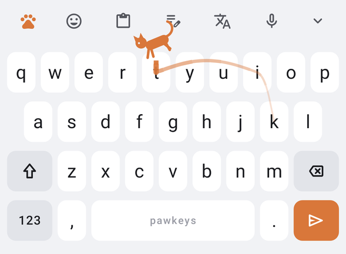
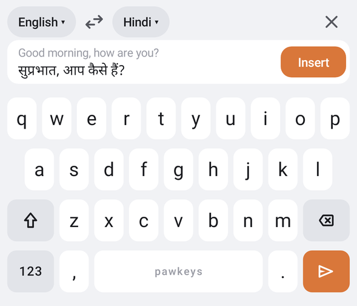

# PawKeys 🐾

An Android keyboard with a calm, minimal look; **Fleksy's gestures**; **Samsung Keyboard's features**; and a light cat theme.

<p>
  
  
</p>
<p>
  
  
</p>

📘 **[Full UI guide and feature list → docs/UI.md](docs/UI.md)**: every screen, with PawKeys' names for each feature.

## Highlights

- **Breeds** (styles): PawKeys (minimal), Samsung, iPhone and Google look and feel. Features stay the same in every breed.
- **Coats** (colours): Calico, Tuxedo, Siamese, Ragdoll, Panther, High contrast, or Auto.
- **Prowl** swipe typing with a curved trail and a little cat chasing your finger.
- **Flicks**: swipe right for space, left to delete a word, down/up to cycle Hunches (suggestions).
- **Hunches** and **Auto-fix**, which learn your words. Backspace undoes a fix.
- **Den**: every tool in one place, with a customizable **Whisker bar**.
- Emoji with search, **Whiskers** cat stickers, GIFs (GIPHY), on-device **Translate** and **Voice** typing.
- **Stash** (clipboard history) and **Groom** (cursor, select, copy, paste, undo).
- **Stretch**, **Single paw** and **Perch** (floating) keyboard.
- Key sounds: click, kitten, cat or duck.

## iPhone version 🍎

PawKeys also runs on iPhone (iOS 16+). The Swift code is in [`ios/`](ios).

**Download:** GitHub builds **PawKeys.ipa** on every change. Get it at
**https://github.com/shreyashgiri/Pawkey/releases/tag/ios-latest**

**Install:** iPhones need the .ipa signed with your Apple ID. You don't need a Mac: use **Sideloadly** on Windows. Step-by-step: **[ios/INSTALL.md](ios/INSTALL.md)**.

**Differences from Android:** Apple doesn't let keyboards insert images, use the microphone or float, so on iPhone:
- stickers and GIFs are copied for you to paste;
- there's no voice typing or Perch;
- Translate uses Apple's on-device translation (iOS 18+);
- sounds, Stash and paste need "Allow Full Access".

## Install and set up (Android)

1. Install the APK (see Build).
2. Open **PawKeys** and follow **Get started**: turn PawKeys on, then switch to it.
3. Optional: for GIFs, paste a free GIPHY key into **Settings → GIFs** (get one at developers.giphy.com).

## Build

**iPhone:** built by GitHub Actions on macOS (`.github/workflows/ios.yml`): XcodeGen generates the project from `ios/project.yml`, tests run on the iPhone simulator, and an unsigned .ipa is published to the `ios-latest` release.

**Android:** requires JDK 17+ and the Android SDK (API 35).

```bash
./gradlew :app:assembleDebug        # app/build/outputs/apk/debug/app-debug.apk
./gradlew :app:testDebugUnitTest    # engine, typing and screenshot tests
python3 tools/make_sounds.py        # regenerate the key sounds
```

The tests:
- `EngineTest`: Auto-fix, Hunches, Prowl decoding, Memory, emoji search.
- `TypingTest`: drives the real keyboard service against a real text field (Auto-fix and undo, Flicks, Groom copy/paste, Translate, Voice, stickers, GIFs).
- `ScreenshotTest`: renders every screen into `app/build/screenshots/`. These renders are the images in `docs/ui`.

## Code layout

```
app/src/main/java/com/pawkeys/keyboard/
  PawKeysIME.kt        the keyboard service: typing, Auto-fix, gestures, panels, translate, voice
  KeyboardView.kt      draws the keys; taps, pop-ups, Flicks, Prowl, Scoot, Scratch
  ProwlTrail.kt        the curved swipe trail and the running cat
  CandidateStrip.kt    the Whisker bar (tools and Hunches)
  Breed.kt             keyboard styles      KeyboardTheme.kt  coats (colours)
  Key.kt               layouts              Feedback.kt       sounds and haptics
  engine/              dictionary, Auto-fix, Prowl decoder, Memory
  panels/              Den, emoji (+search), Stash, Groom, Coats, Breeds, Stretch, Perch
  stickers/ gifs/ translate/ voice/ settings/
tools/make_sounds.py   generates the click / kitten / cat / duck sounds
```

## Credits
- Word frequencies come from [FrequencyWords](https://github.com/hermitdave/FrequencyWords) by Hermit Dave (CC BY-SA 4.0).
- Icons are from [Material Symbols](https://github.com/google/material-design-icons) (Apache 2.0).
- Translation uses [Google ML Kit](https://developers.google.com/ml-kit/language/translation).
- GIFs are powered by [GIPHY](https://giphy.com).
- Stickers, sounds and the running cat are original to PawKeys.
