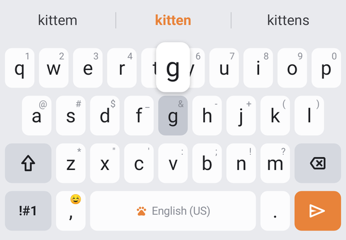
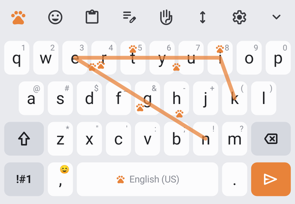
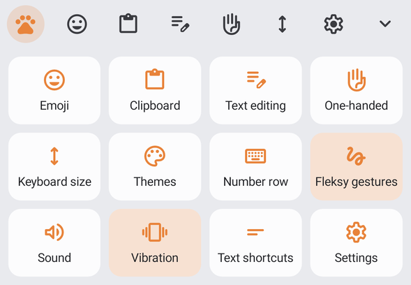
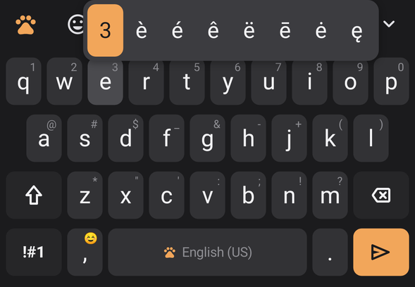
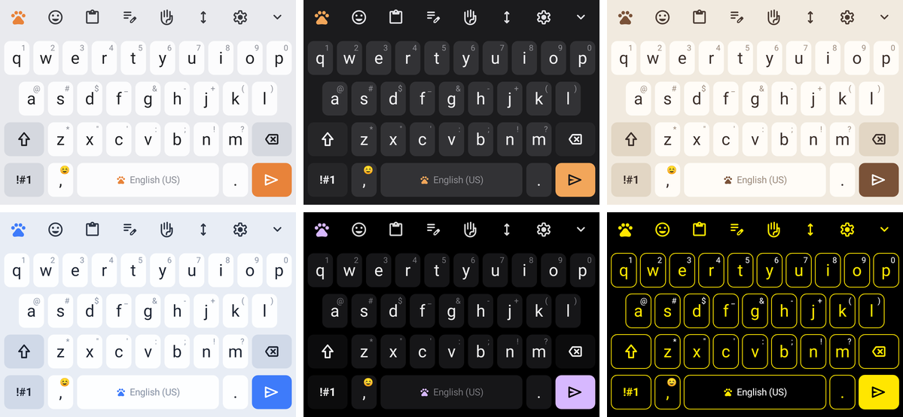

# Pawkey 🐾

An Android keyboard that combines **Fleksy's gestures** with **Samsung Keyboard's features**. It looks like Samsung's One UI keyboard, with a light cat theme on top: paw prints, cat-coat theme names and a cat emoji tab.

<p>
  
  
</p>
<p>
  
  
</p>
<p>
  
  
</p>



## Features

### From Fleksy
| Gesture | What it does |
|---|---|
| Swipe right | Space (and accepts the autocorrection) |
| Swipe right twice | Full stop + space |
| Swipe down / up after a full stop | Cycles `. , ? ! : ;` |
| Swipe left | Deletes the previous word |
| Swipe down / up after a word | Swaps it for the next or previous suggestion |
| Swipe up (nothing to cycle) | Shift |

Fleksy-style smart punctuation also applies: after a swipe-space or a picked suggestion, typing `. , ! ? ; :` moves the space so it comes after the punctuation.

### From Samsung Keyboard
- **Toolbar** above the keys: emoji, clipboard, text editing, one-handed mode, keyboard size, settings and hide. It switches to **three suggestions**, best one in the middle, while you type.
- **Swipe typing**: draw a word across the keys. Turn it on in *Settings → Keyboard swipe controls* or from the Paw menu.
- **Spacebar cursor control**: slide along the spacebar to move the cursor.
- **Swipe left from backspace**: selects whole words, and deletes them when you let go.
- **Alternative characters** shown on the keys. Long-press any key for symbols and accents (é, ñ, ß…).
- **Clipboard history** with pinning. Text marked sensitive, like passwords from password managers, is never saved.
- **Text editing panel**: arrow keys, select mode, select all, copy, cut, paste, undo, redo, Home and End.
- **One-handed mode** (left or right) and **keyboard size** adjustment with a live preview.
- **Text shortcuts**: type `omw`, then tap "On my way! 🐾" in the suggestion bar.
- **Auto replace** with undo: press backspace straight after a correction to get your word back.
- Auto-capitalisation, double-space full stop and an optional number row.
- A **number pad** for number and phone fields. Email and URL fields get `@` or `/` in place of the comma key.
- The keyboard **learns new words** and **predicts your next word**, all stored on your phone. Long-press a suggestion to stop it being offered.
- Key sound, vibration (adjustable strength), character preview and long-press delay.
- Password fields get no suggestions and no learning, and the number row appears automatically.
- Long-press the spacebar to switch to another keyboard.

### Cat touches 🐱
- Six themes: **Calico** (light), **Tuxedo** (dark), **Siamese** (cream), **Ragdoll** (blue), **Black Panther** (AMOLED) and **High contrast**. *Follow system* switches between Calico and Tuxedo with dark mode.
- A paw on the spacebar, a **Paw menu** with every feature in one grid, and paw prints along the swipe-typing trail.
- A **Cats** emoji tab.

## Install and set up

1. Build the APK (see below) or install `app-debug.apk` on your phone.
2. Open **Pawkey** from the app drawer and follow the **Get started** steps: turn Pawkey on, then switch to it.
3. Type in the test box at the top of the settings screen to try it out.

## Build

You need JDK 17+ and the Android SDK (API 35).

```bash
./gradlew :app:assembleDebug        # app/build/outputs/apk/debug/app-debug.apk
./gradlew :app:testDebugUnitTest    # engine, typing and screenshot tests
```

The tests include:
- `EngineTest`: autocorrect, completions and swipe-typing decoding against the real word list.
- `TypingTest`: drives the real keyboard service against a real `EditText` (autocorrect and undo, Fleksy gestures, double-space, shortcuts).
- `ScreenshotTest`: renders every theme and panel to `app/build/screenshots/` with Robolectric. This is how the images above were made.

## Code layout

```
app/src/main/java/com/pawkey/keyboard/
  PawkeyIME.kt          the input method service: typing, autocorrect, gestures, panels
  KeyboardView.kt       draws keys, handles taps, popups, flicks, swipe typing, spacebar/backspace swipes
  CandidateStrip.kt     Samsung-style toolbar / suggestion bar
  Key.kt                key model and layouts (QWERTY, symbols, number pad, phone)
  KeyboardTheme.kt      the cat-coat themes
  engine/               dictionary + autocorrect, swipe-typing decoder, learned words
  panels/               emoji, clipboard, text editing, paw menu, themes, size bar, one-handed rail
  settings/             settings screen and text shortcut editor
```

## Credits
- Word frequencies come from [FrequencyWords](https://github.com/hermitdave/FrequencyWords) by Hermit Dave (CC BY-SA 4.0), filtered and with contractions added.
- Icons are from [Material Symbols](https://github.com/google/material-design-icons) (Apache 2.0).
