# PawKeys: UI guide and feature list

This document describes every part of the PawKeys keyboard: what it looks like, how it's measured, and how it behaves. Every image is a real render of the app, produced by `ScreenshotTest` (`./gradlew :app:testDebugUnitTest --tests '*ScreenshotTest*'`). Re-run it after UI changes and copy `app/build/screenshots/*` into `docs/ui/`.

**Design direction:** it looks and feels like Samsung's One UI keyboard (flat, softly rounded keys, grey function keys, a toolbar above the keys), with Fleksy's gestures. The cat theme stays subtle: a single cat-coloured accent per theme, a paw on the spacebar, a paw menu, paw prints on the swipe trail, and a Cats emoji tab. There are no cat pictures on the keys.

## Contents
1. [Overall structure](#1-overall-structure)
2. [Main keyboard (letters)](#2-main-keyboard-letters)
3. [Shift and caps lock](#3-shift-and-caps-lock)
4. [Symbol pages](#4-symbol-pages)
5. [Layouts for special fields](#5-layouts-for-special-fields)
6. [Top strip: toolbar and suggestions](#6-top-strip-toolbar-and-suggestions)
7. [Key preview and long-press popups](#7-key-preview-and-long-press-popups)
8. [Gestures](#8-gestures)
9. [Paw menu](#9-paw-menu)
10. [Emoji panel](#10-emoji-panel)
11. [Clipboard panel](#11-clipboard-panel)
12. [Text editing panel](#12-text-editing-panel)
13. [Themes](#13-themes)
14. [Keyboard size](#14-keyboard-size)
15. [One-handed mode](#15-one-handed-mode)
16. [Settings app](#16-settings-app)
17. [Feature list](#17-feature-list)

---

## 1. Overall structure

```
┌──────────────────────────────────────────────┐
│ Top strip (46dp): toolbar  ⇄  suggestions    │  ← the size bar replaces it while resizing
├──────────────────────────────────────────────┤
│                                              │
│ Key area: KeyboardView, or a panel           │  ← emoji / clipboard / text editing /
│ (the same height, so nothing jumps)          │    paw menu / themes panel
│                                              │
└──────────────────────────────────────────────┘
```

- In one-handed mode the key area shrinks to 82% of the width, and a rail with two buttons takes the other 18%.
- Key previews and popups can float above the top row, over the strip. To allow this, the parent views don't clip their children.
- Code: `PawKeysIME.onCreateInputView()`.

## 2. Main keyboard (letters)


| Row | Keys |
|---|---|
| 1 | `q w e r t y u i o p`, with hints `1 2 3 4 5 6 7 8 9 0` |
| 2 | `a s d f g h j k l`, with hints `@ # $ _ & - + ( )`, indented half a key on each side |
| 3 | **Shift** (1.5 wide) · `z x c v b n m` with hints `* " ' : ; ! ?` · **Backspace** (1.5 wide) |
| 4 | **!#1** (1.5) · **,** (hint ☺) · **Space** (5 wide) · **.** · **Enter** (1.5, accent colour) |

**Measurements** (all scaled by the keyboard size setting):

| Item | Value |
|---|---|
| Row height | 54dp |
| Gap between keys | 5.2dp horizontal, 9dp vertical |
| Corner radius | 8dp |
| Keyboard padding | 4dp top, 6dp bottom, 3dp sides |
| Letter label | 22sp, regular |
| Function key label (`!#1`, `ABC`) | 15sp, bold |
| Hint character | 10.5sp, top-right corner, in the theme's hint colour |
| Icons | 24dp (Material Symbols Rounded) |

**Key colours:**
- Letter, comma, full stop and space keys use the theme's key colour.
- Shift, backspace and `!#1` use the darker function-key colour.
- Enter is filled with the theme's accent.

**Spacebar:** a small paw in the accent colour, followed by "English (US)" in the hint colour.

**Enter key:** the icon changes with what the app asks for.

| Field action | Icon |
|---|---|
| Send | paper plane |
| Search | magnifier |
| Go / Next | arrow |
| Done | tick |
| Plain text (no action) | return arrow |

Hints can be hidden in Settings ("Show alternative characters"); they still work on long-press. Turning on **Number row** adds a 1–0 row on top and removes the number hints:

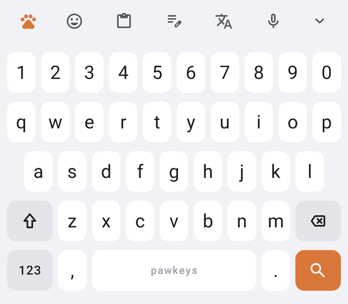

## 3. Shift and caps lock

| Off | Shift (one capital) | Caps lock |
|---|---|---|
|  | 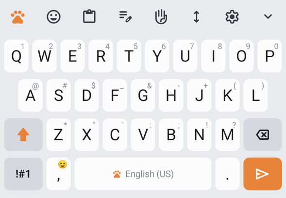 |  |

- **Tap Shift:** capitalises one letter. The arrow fills with the accent colour and the labels switch to capitals.
- **Double-tap Shift** (within 350ms): caps lock. The filled arrow gets an underline.
- **Hold Shift while tapping a letter:** types a capital.
- **Auto-capitalisation:** Shift turns on by itself at the start of a sentence.

## 4. Symbol pages

| `!#1` → page 1/2 | `1/2` → page 2/2 |
|---|---|
| 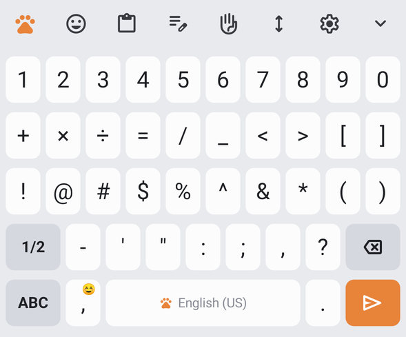 | 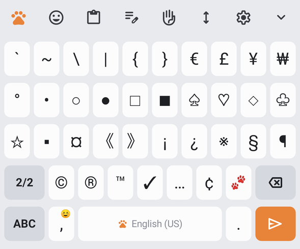 |

- **Page 1:** numbers; `+ × ÷ = / _ < > [ ]`; `! @ # $ % ^ & * ( )`; `- ' " : ; , ?`.
- **Page 2:** `` ` ~ \ | { } € £ ¥ ₩ ``; shapes `° • ○ ● □ ■ ♤ ♡ ◇ ♧`; `☆ ▪ ¤ 《 》 ¡ ¿ ※ § ¶`; `© ® ™ ✓ … ¢ 🐾`.
- `ABC` returns to the letters.
- Many symbols have long-press extras: `$` gives € £ ¥ ₹ ₩ ¢, `=` gives ≠ ≈ ±, `-` gives – — ·, and quote marks give curly quotes.

## 5. Layouts for special fields

The keyboard changes by itself to suit the field you're typing in:

| Number field (Done) | Phone field (Go) |
|---|---|
| 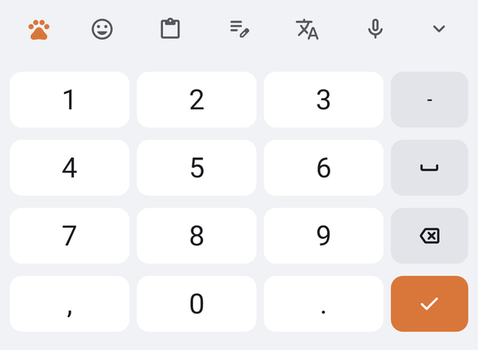 | 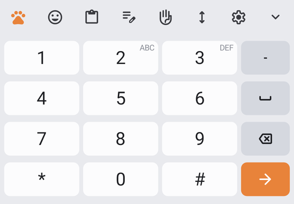 |

| Email field: comma becomes `@` | Web address: comma becomes `/` |
|---|---|
| 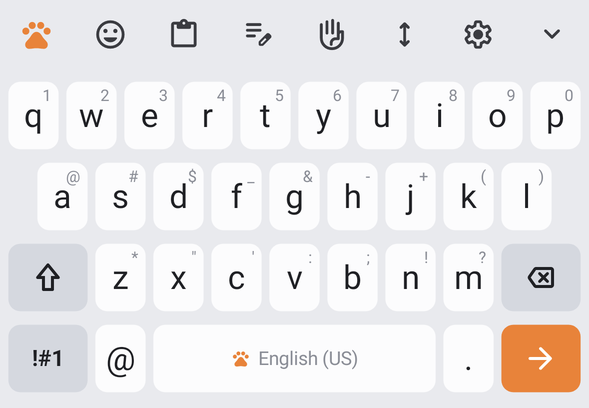 | 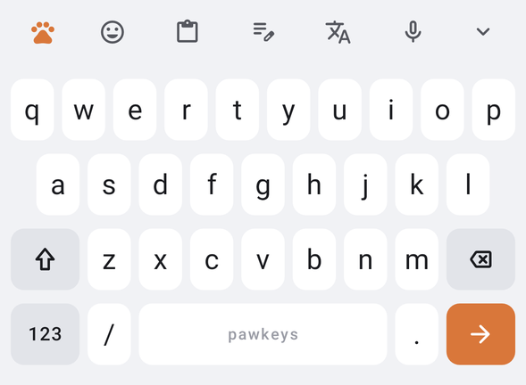 |

- **Email and web addresses:** long-press `.` for `.com .net .org .io`. Autocorrect and auto-capitals are off.
- **Password fields:** the number row appears automatically. There are no suggestions, and nothing is learned or saved.

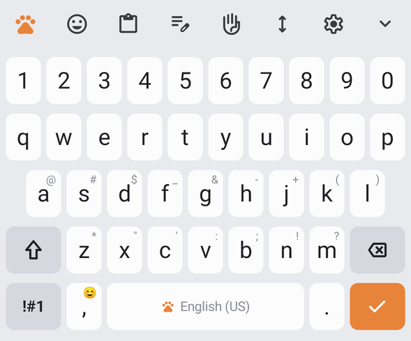

## 6. Top strip: toolbar and suggestions

**Toolbar** (shown when you're not typing a word). Eight evenly spaced 23dp icons:

| Icon | Action |
|---|---|
| 🐾 paw (always accent colour) | Opens the **Paw menu** |
| ☺ | Emoji panel |
| 📋 | Clipboard panel |
| ✎ | Text editing panel |
| ✋ | Toggle one-handed mode |
| ↕ | Keyboard size bar |
| ⚙ | Settings app |
| ⌄ | Hide keyboard |

When a panel is open, its icon turns accent-coloured and sits on a soft accent-coloured circle.

**Suggestions** (shown while typing). Three slots, Samsung style, with the **best one in the middle** in bold:

| State | Look |
|---|---|
| Autocorrect will apply on space | 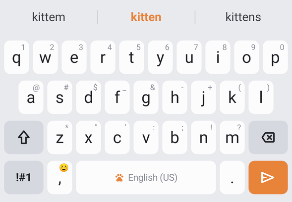 |
| Completions (the word you typed is real) | 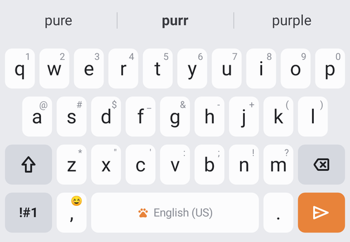 |
| Text shortcut matched (`omw`) | 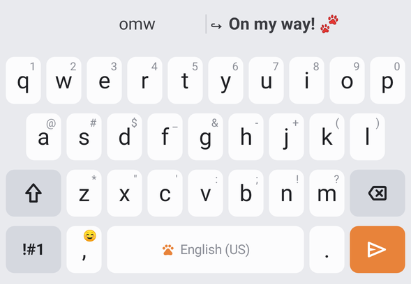 |

- **Autocorrect:** the correction it will apply is drawn in the **accent colour**. Your literal typing sits on the left so you can keep it.
- **Shortcut expansions** start with `↪`.
- Suggestion text is 16sp, with thin dividers between slots.
- **Tap a suggestion:** inserts it plus a space.
- **Long-press a suggestion:** stops PawKeys suggesting that word ("won't be suggested again").
- **After a space:** next-word predictions learned from your typing appear. If there aren't any, the toolbar returns.

## 7. Key preview and long-press popups

| Key preview | Long-press a letter | Long-press `.` |
|---|---|---|
| 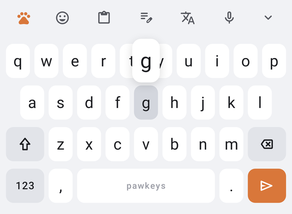 | 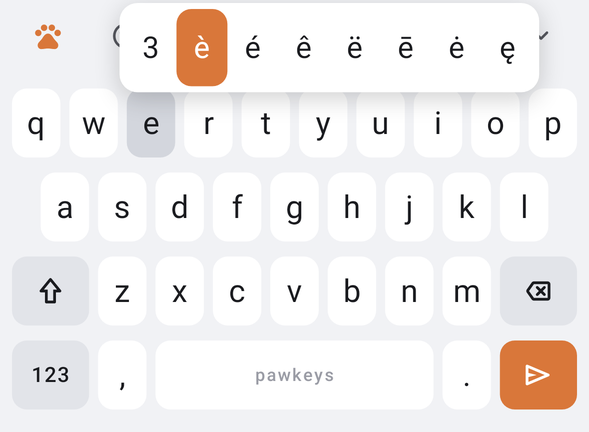 | 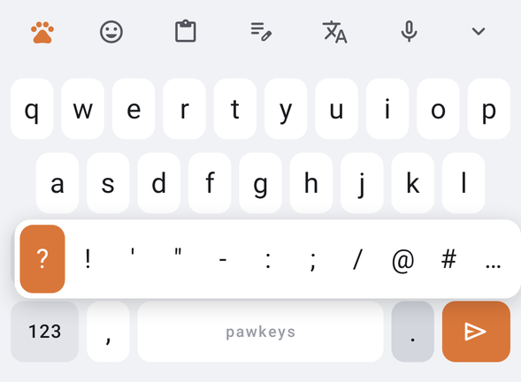 |

**Key preview:**
- A white rounded bubble (1.15× the key's width, 1.05× a row's height) with a 30sp letter, floating above the key with a soft shadow.
- The pressed key darkens.
- Can be turned off ("Character preview").

**Long-press popup:**
- Appears after 300ms (adjustable from 150 to 800ms).
- The first item is the key's hint, then its accents, e.g. `e` gives `3 è é ê ë ē ė ę`.
- Slide your finger to choose; the selected cell fills with the accent colour. Lift to type it.
- Items stay on one row if they fit, otherwise they wrap. The popup is never pushed off the top of the screen.
- Long-pressing the comma's ☺ opens the emoji panel.

## 8. Gestures

Choose under **Settings → Keyboard swipe controls**, or with the Gestures tile in the Paw menu.

**Fleksy gestures** (default). A flick is a swipe longer than 0.7 of a key's width:

| Gesture | Result |
|---|---|
| Swipe right | Space (and applies the autocorrection) |
| Swipe right again | Full stop and space: `word. ` |
| Swipe down or up after that | Cycles `. , ? ! : ;` |
| Swipe left | Deletes the previous word |
| Swipe down or up after a word | Swaps it for the next or previous suggestion |
| Swipe up with nothing to cycle | Shift |

**Swipe typing (Samsung).** Drag across the letters; an accent trail follows your finger, with optional paw prints:


- The word is decoded when you lift your finger, and a space is added before it automatically.
- Alternatives appear in the strip.
- Backspace straight afterwards removes the whole swiped word.

**These work in every mode:**
- **Spacebar cursor:** slide along the spacebar to move the cursor one character per 0.4 key widths.
- **Long-press the spacebar:** opens the keyboard switcher.
- **Backspace swipe:** slide left from Backspace and whole words get selected (one more word every 0.8 key widths). Lift to delete them, or slide back to cancel.
- **Hold Backspace:** after 380ms it repeats every 60ms, speeding up to every 30ms.

## 9. Paw menu


- A 4×3 grid of rounded tiles (12dp corners), each with an accent-coloured icon and a label.
- Settings that are switched on (One-handed, Number row, Gestures, Sound, Vibration) get a soft accent-tinted tile.
- Tiles: Emoji, Clipboard, Text editing, One-handed, Keyboard size, Themes, Number row, Gestures (cycles Fleksy → Swipe typing → Off), Sound, Vibration, Text shortcuts, Settings.

## 10. Emoji panel

| Light | Dark |
|---|---|
| 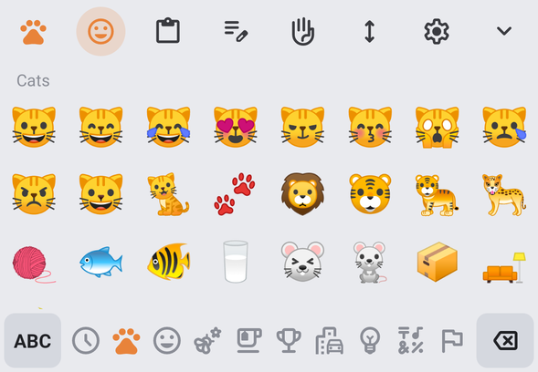 | 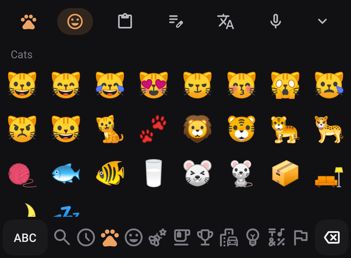 |

- **Grid:** 8 columns of square cells; emoji are 58% of the cell.
- **Category name** in small grey text above the grid.
- **Bottom bar:** `ABC`, then category icons (Recent, **Cats**, Smileys, Animals, Food, Activities, Travel, Objects, Symbols, Flags), then Backspace (repeats when held). The selected category is accent-coloured.
- **Recent:** keeps your last 32 emoji. If it's empty, it says "Emojis you use will curl up here 🐾".
- Emoji your phone's font can't draw are hidden automatically (for example the black cat on older Android versions).

## 11. Clipboard panel

| History | After pinning |
|---|---|
| 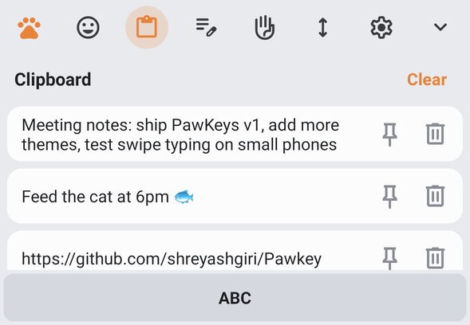 | 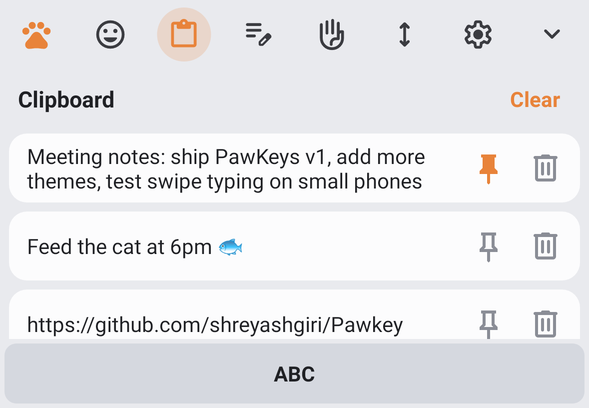 |

- **Header:** "Clipboard" in bold, with an accent-coloured **Clear** button that removes everything except pinned clips.
- **Each clip** is a rounded card showing up to 2 lines of text, plus 📌 pin and 🗑 delete buttons. Pinned clips move to the top and their pin turns accent-coloured.
- **Tap a card** to paste it.
- Keeps the 30 most recent clips; pinned ones are kept forever. Text marked sensitive (such as passwords from password managers) is never stored. History can be turned off in Settings.

## 12. Text editing panel

| Normal | Select mode on |
|---|---|
| 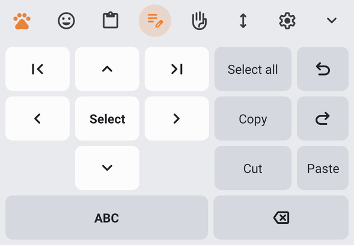 | 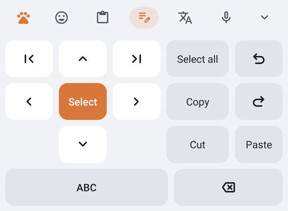 |

- **Left: cursor pad.** `↑ ← → ↓` (repeat when held), `|<` Home, `>|` End, and **Select** in the middle. Select fills with the accent colour, and then the arrows extend the selection.
- **Right: actions.** Select all, Copy, Cut, Paste, Undo and Redo.
- **Bottom:** `ABC` back to the keyboard, and Backspace.

## 13. Themes

Pick from the Paw menu → **Themes**, or from Settings:

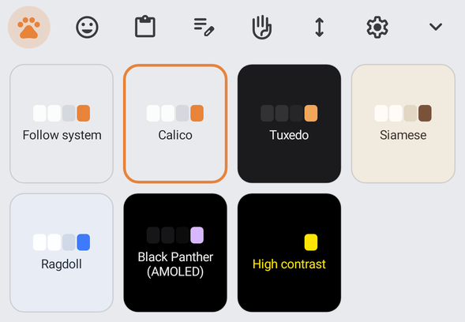

| Calico (light, default by day) | Tuxedo (dark, default by night) | Siamese (cream) |
|---|---|---|
|  | 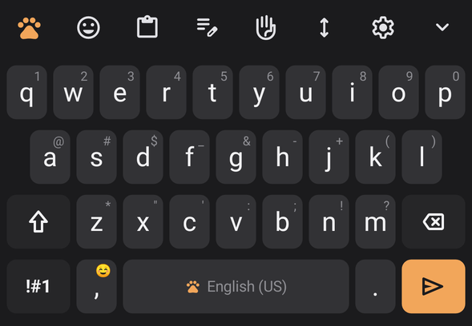 | 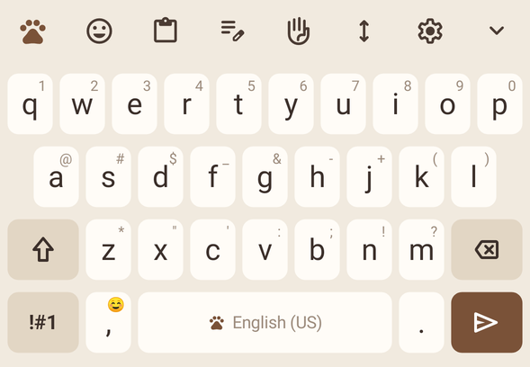 |

| Ragdoll (blue) | Black Panther (AMOLED) | High contrast |
|---|---|---|
| 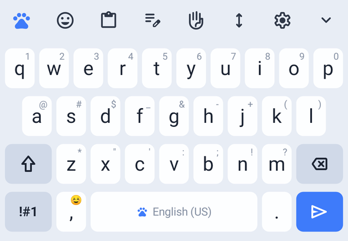 | 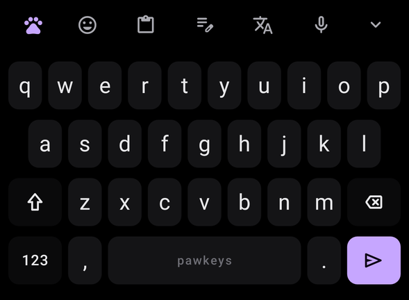 | 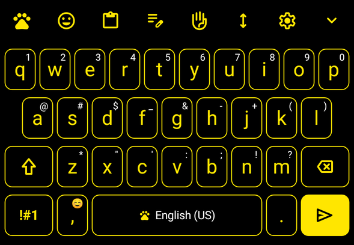 |

| Theme | Background | Key | Function key | Text | Accent |
|---|---|---|---|---|---|
| Calico | `#E9EAEE` | `#FCFCFD` | `#D5D8DF` | `#1F2024` | `#E8833A` ginger |
| Tuxedo | `#1B1B1D` | `#323235` | `#262628` | `#F2F2F4` | `#F2A65A` |
| Siamese | `#F1EADF` | `#FFFCF7` | `#E2D6C4` | `#3B2F2A` | `#7A5238` seal brown |
| Ragdoll | `#E8EDF5` | `#FDFEFF` | `#D0D9E8` | `#1C2433` | `#3E7BFA` blue eyes |
| Black Panther | `#000000` | `#161618` | `#0C0C0D` | `#EDEDED` | `#D7B8FF` lavender |
| High contrast | `#000000` | `#000000` + yellow border | `#000000` | `#FFE600` | `#FFE600` |

- **Follow system** uses Calico in light mode and Tuxedo in dark mode.
- **Key borders** can be switched on for any theme.
- The phone's navigation bar is coloured to match the keyboard.

## 14. Keyboard size

| Size bar (keys stay visible and resize live) | 85% size |
|---|---|
| 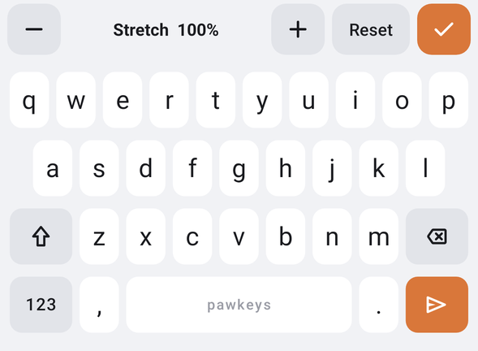 | 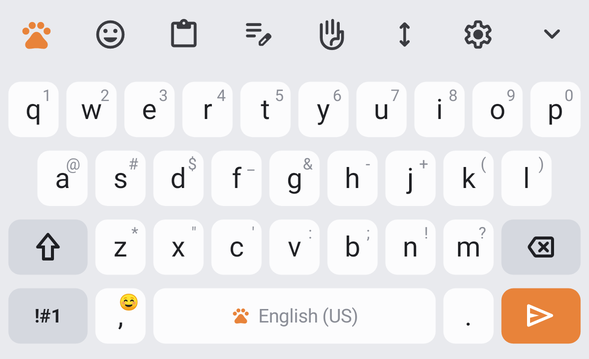 |

- **Size bar:** `−` and `+` change the height in 5% steps from 70% to 140%, **Reset** goes back to 100%, and the accent ✓ saves.
- In landscape the keyboard is automatically drawn at 78% of the chosen height.

## 15. One-handed mode

| Right hand | Left hand |
|---|---|
| 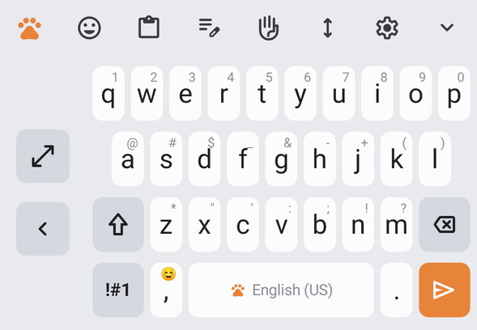 | 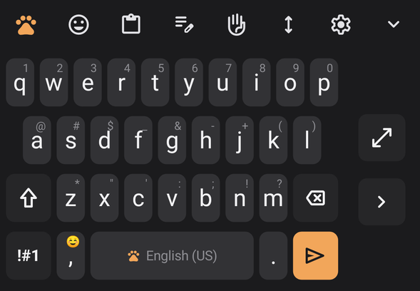 |

- The keys take 82% of the width on your hand's side.
- The rail on the other side has ⤢ (back to full width) and an arrow that moves the keyboard to the other side.
- Toggle it from the ✋ toolbar icon.

## 16. Settings app

| Settings (launcher app "PawKeys") | Text shortcuts |
|---|---|
| 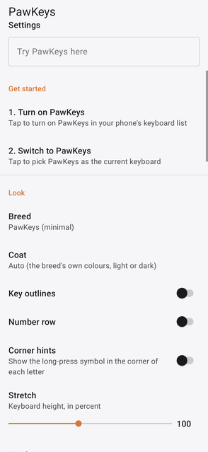 | 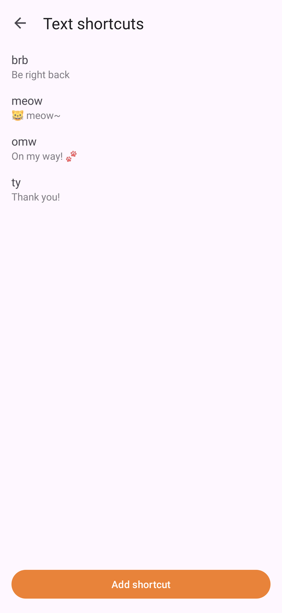 |

- **Top of the screen:** a "Try PawKeys here" text box, and **Get started** steps. Step 1 opens the system keyboard list; step 2 opens the keyboard switcher. The steps hide themselves once both are done.
- **Look and feel:** Theme, Key borders, Number row, Show alternative characters, Keyboard size, One-handed mode.
- **Smart typing:** Predictive text, Auto replace, Next-word suggestions, Learn new words, Block offensive words, Auto capitalise, Double-space for full stop, Smart punctuation, Text shortcuts, Forget learned words.
- **Swipe and gestures:** Keyboard swipe controls, Spacebar cursor control, Swipe left from backspace, Paw-print swipe trail.
- **Feedback:** Sound, Vibration, Vibration strength, Character preview, Long-press delay.
- **Clipboard:** Clipboard history.
- **Text shortcuts screen:** a list of shortcut and expansion pairs. Tap one to edit or delete it; **Add shortcut** creates a new one. The defaults are `omw`, `brb`, `ty` and `meow`.

---

## 17. Feature list

Legend: **F** = from Fleksy, **S** = from Samsung Keyboard, **🐾** = PawKeys extra. ✅ = built.

### Typing and suggestions
| | Feature | From |
|---|---|---|
| ✅ | Three-slot suggestion bar, best in the middle | S |
| ✅ | Word completions ranked by how common the word is (30,000-word list) | S/F |
| ✅ | Auto replace on space and punctuation; typos on neighbouring keys cost less | S/F |
| ✅ | Backspace straight after a correction restores your word (and learns it) | S/F |
| ✅ | Learns new words; next-word predictions from your own typing | S |
| ✅ | Long-press a suggestion to remove it | S |
| ✅ | Text shortcuts, with an editor | S |
| ✅ | Auto-capitalise, double-space full stop | S |
| ✅ | Smart punctuation: the space moves to after the punctuation | F |
| ✅ | Backspace into a word brings its suggestions back | S |
| ✅ | Offensive words never suggested (toggle) | S |
| ✅ | Password fields: no suggestions or learning; incognito fields: no learning | S |

### Gestures
| | Feature | From |
|---|---|---|
| ✅ | Swipe right = space; twice = full stop | F |
| ✅ | Swipe left = delete word | F |
| ✅ | Swipe down / up = cycle suggestions or punctuation | F |
| ✅ | Swipe typing with alternatives in the strip | S |
| ✅ | Paw-print swipe trail | 🐾 |
| ✅ | Spacebar cursor control | S |
| ✅ | Swipe left from backspace to select and delete words | S |
| ✅ | Hold backspace to repeat, speeding up | S |
| ✅ | Long-press the spacebar to switch keyboards | S |

### Keys and layouts
| | Feature | From |
|---|---|---|
| ✅ | Hint characters on the keys and long-press for symbols and accents | S |
| ✅ | Key preview bubble | S |
| ✅ | Shift, double-tap caps lock, and hold Shift for a capital | S |
| ✅ | Two symbol pages | S |
| ✅ | Optional number row (always shown in password fields) | S |
| ✅ | Number and phone pads; `@` and `/` keys for email and web addresses | S |
| ✅ | Enter icon matches the app's action (send, search, go, next, done) | S |
| ✅ | Fast typing with two thumbs (the second finger doesn't cancel the first) | S/F |

### Toolbar and panels
| | Feature | From |
|---|---|---|
| ✅ | Toolbar that turns into suggestions while typing | S |
| ✅ | Paw menu with every feature | 🐾 (Samsung's expanded toolbar) |
| ✅ | Emoji panel: categories, recents, **Cats** tab | S + 🐾 |
| ✅ | Clipboard history with pin, delete and clear | S |
| ✅ | Text editing panel: arrows, select, copy, cut, paste, undo, redo, Home, End | S |
| ✅ | One-handed mode, left or right | S |
| ✅ | Live keyboard size bar | S/F |

### Look and feel
| | Feature | From |
|---|---|---|
| ✅ | One UI look: flat, rounded keys and grey function keys | S |
| ✅ | 6 cat-coat themes plus Follow system | 🐾 |
| ✅ | Optional key borders, high-contrast theme | S |
| ✅ | Navigation bar matches the keyboard colour | S |
| ✅ | Paw on the spacebar, paw launcher icon | 🐾 |
| ✅ | Sound, vibration strength, long-press delay | S |

### Not built yet
| Feature | Notes |
|---|---|
| Other languages | Needs a word list and layout per language |
| Voice typing | Could hand off to the phone's voice keyboard |
| GIFs and stickers | Needs a GIF service and an API key |
| Floating keyboard | Needs a different window type on Android |
| Handwriting | Large separate feature |
