# PawKeys: UI guide and feature list

PawKeys is an Android keyboard with a minimal, spacious look; Fleksy-style gestures; Samsung-keyboard features; and a light cat theme. This guide describes every part of the UI, what it's called, how it looks and how it behaves.

Every image is a real render of the app made by `ScreenshotTest`. To refresh them, run `./gradlew :app:testDebugUnitTest --tests '*ScreenshotTest*'` and copy `app/build/screenshots/*` into `docs/ui/`.

## PawKeys names

PawKeys uses its own names for its features. Universal things (Emoji, Stickers, GIFs, Translate, Voice) keep their usual names.

| PawKeys name | What it is |
|---|---|
| **Whisker bar** | The bar above the keys |
| **Hunches** | Word suggestions and next-word predictions |
| **Auto-fix** | Autocorrect |
| **Den** | The menu with every tool (the paw button) |
| **Breeds** | Keyboard styles: PawKeys, Samsung, iPhone, Google |
| **Coats** | Colour themes |
| **Stash** | Clipboard history |
| **Groom** | Text editing panel (cursor, select, copy, paste) |
| **Stretch** | Keyboard size |
| **Single paw** | One-handed mode |
| **Perch** | Floating keyboard |
| **Flicks** | Swipe gestures on the letters |
| **Prowl** | Swipe typing, with the running-cat trail |
| **Scoot** | Slide on the spacebar to move the cursor |
| **Scratch** | Slide left from backspace to erase words |
| **Tricks** | Text shortcuts (type `omw` → "On my way!") |
| **Memory** | Words PawKeys has learned from you |

## Contents
1. [Layout of the keyboard](#1-layout-of-the-keyboard)
2. [Breeds: keyboard styles](#2-breeds-keyboard-styles)
3. [The keys](#3-the-keys)
4. [Shift and caps lock](#4-shift-and-caps-lock)
5. [Symbols](#5-symbols)
6. [Layouts for special fields](#6-layouts-for-special-fields)
7. [Whisker bar and Hunches](#7-whisker-bar-and-hunches)
8. [Customize the Whisker bar](#8-customize-the-whisker-bar)
9. [Key pop-up and long-press](#9-key-pop-up-and-long-press)
10. [Gestures: Flicks, Prowl, Scoot, Scratch](#10-gestures-flicks-prowl-scoot-scratch)
11. [Den](#11-den)
12. [Emoji and emoji search](#12-emoji-and-emoji-search)
13. [Stickers](#13-stickers)
14. [GIFs](#14-gifs)
15. [Stash (clipboard)](#15-stash-clipboard)
16. [Groom (text editing)](#16-groom-text-editing)
17. [Translate](#17-translate)
18. [Voice](#18-voice)
19. [Coats (colour themes)](#19-coats-colour-themes)
20. [Stretch, Single paw and Perch](#20-stretch-single-paw-and-perch)
21. [Key sounds](#21-key-sounds)
22. [Settings app](#22-settings-app)
23. [Feature list](#23-feature-list)

---

## 1. Layout of the keyboard

```
┌──────────────────────────────────────────────┐
│ Whisker bar (48dp)                           │ ← becomes the Translate, Voice, search
│ 🐾 Den · pinned tools · ⌄ Hide  /  Hunches   │   or Stretch bar while those are in use
├──────────────────────────────────────────────┤
│                                              │
│ Keys, or a panel of the same height          │ ← Den, Emoji, Stickers, GIFs, Stash,
│                                              │   Groom, Coats, Breeds, languages
└──────────────────────────────────────────────┘
```

- **Panels** take exactly the keys' height, so nothing jumps when they open.
- **Single paw** narrows the keys to 82% with a side rail.
- **Perch** turns the whole keyboard into a floating card.
- **Key pop-ups** float above the top row, over the Whisker bar.

## 2. Breeds: keyboard styles

A breed sets the key shape, spacing, enter key, labels, bottom row and native colours. Every feature stays PawKeys' own whichever breed you pick. With the **Auto** coat each breed uses its own light/dark colours; any other coat repaints the breed in that coat.

| | Light | Dark |
|---|---|---|
| **PawKeys** (default): the most spacious, 10dp corners, accent enter key, quiet `pawkeys` wordmark on the spacebar |  | 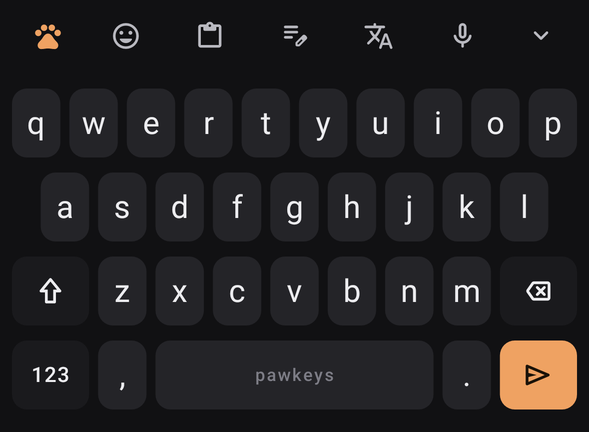 |
| **Samsung**: One UI proportions, grey enter key, `!#1`, "English (US)" | 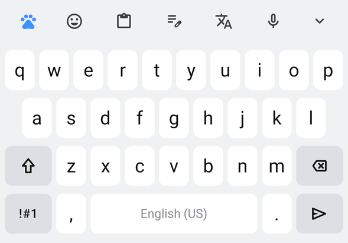 | 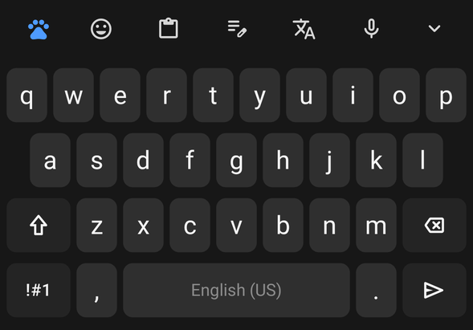 |
| **iPhone**: thin key shadow, `123 · 🙂 · space · return` row, text enter key that turns blue for send, search and go | 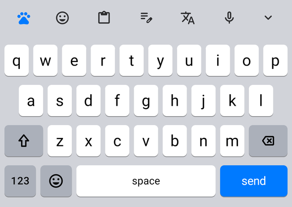 | 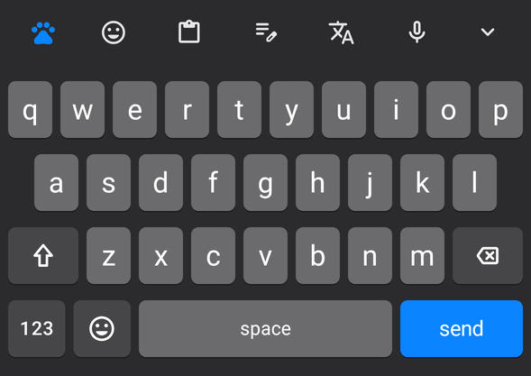 |
| **Google**: Gboard row with an emoji key, pill-shaped enter key, `?123` | 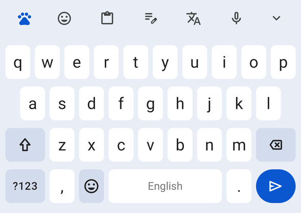 | 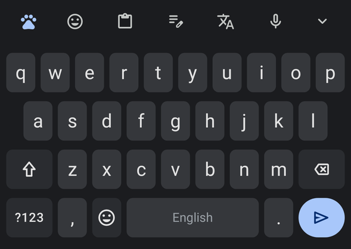 |

Pick a breed in **Den → Breeds** or **Settings → Look → Breed**.

| Breeds panel | iPhone symbols page (`#+=`, blue "search") |
|---|---|
| 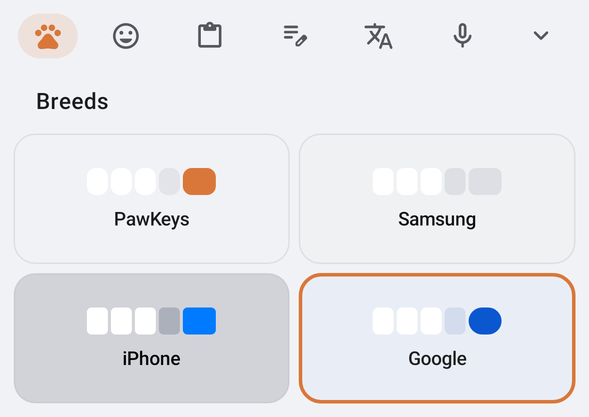 | 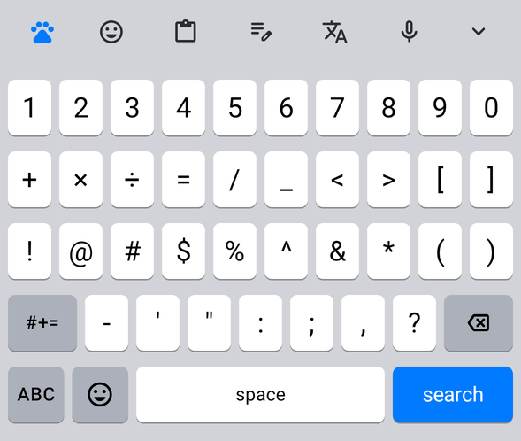 |

| | PawKeys | Samsung | iPhone | Google |
|---|---|---|---|---|
| Row height | 56dp | 54dp | 54dp | 54dp |
| Gap between keys (h × v) | 6 × 10dp | 5 × 9dp | 6 × 12dp | 6 × 10dp |
| Corner radius | 10dp | 8dp | 5.5dp | 7dp |
| Enter key | Accent, rounded | Grey, icon | Text label; blue for actions | Accent pill |
| Symbols key | `123` | `!#1` | `123` | `?123` |

## 3. The keys


- **Rows:** `q w e r t y u i o p` · `a s d f g h j k l` (inset half a key) · Shift, `z x c v b n m`, Backspace · `123`, `,`, Space, `.`, Enter.
- **Letters:** 21sp regular. Function labels are 14sp medium with slight letter spacing; icons are 22dp.
- **Colours:** letter keys use the coat's key colour; Shift, Backspace and `123` use the darker function colour.
- **Corner hints** (the long-press symbol on each key) are off by default for a cleaner look. Turn them on in Settings → Look.
- **Number row:** optional; it appears automatically in password fields.


## 4. Shift and caps lock

| Off | Shift (one capital) | Caps lock (double-tap) |
|---|---|---|
|  |  |  |

Hold Shift while tapping a letter for a single capital. Shift turns on by itself at the start of a sentence.

## 5. Symbols

| `123` → page 1 | `=\<` → page 2 |
|---|---|
|  |  |

Long-press a symbol for related ones. For example, `$` gives € £ ¥ ₹ ₩ ¢, `-` gives – —, and quote marks give curly quotes.

## 6. Layouts for special fields

| Number field | Phone field |
|---|---|
|  |  |

| Email: `@` replaces the comma | Web address: `/` replaces the comma |
|---|---|
|  |  |

- **Email and web fields:** Auto-fix and auto capitals are off. Long-press `.` for `.com .net .org .io`.
- **Password fields:** the number row shows automatically, there are no Hunches, and nothing is learned.


## 7. Whisker bar and Hunches

**When you're not typing**, the bar holds:
- 🐾 **Den** on the left;
- your pinned tools (default: Emoji, Stash, Groom, Translate, Voice);
- ⌄ **Hide** on the right.

Icons are 21dp. The open panel's tool sits on a soft accent-coloured pill.

**While typing**, it shows three **Hunches**:
- The strongest is in the middle, in medium weight.
- The word **Auto-fix** will use is in the accent colour, with your literal typing on the left so you can keep it.
- **Tricks** expansions start with `↪`.
- Long-press a hunch to stop PawKeys suggesting it.

| Auto-fix ready | Completions | Trick (text shortcut) |
|---|---|---|
|  |  |  |

## 8. Customize the Whisker bar

**Den → Customize** switches the Den to pinning mode:
- Tap tools to pin or unpin them. Badges number each pinned tool by its position on the bar; `+` means not pinned.
- Up to 5 tools fit. **Reset bar** restores the defaults.
- The bar above updates live.

| Customize mode | A custom bar (Emoji, Stash, Coats, Sound) |
|---|---|
| 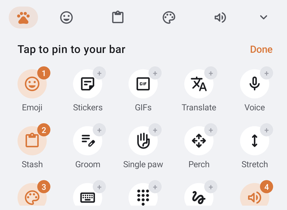 |  |

## 9. Key pop-up and long-press

| Key pop-up | Long-press a letter | Long-press `.` |
|---|---|---|
|  |  |  |

- **Key pop-up:** a white bubble with a 28sp letter and a soft shadow.
- **Long-press:** after 300ms (adjustable from 150 to 800ms) a row of alternatives appears. Slide to choose, then lift. The selected cell is filled with the accent colour. The popup wraps into two rows if needed and never leaves the screen.

## 10. Gestures: Flicks, Prowl, Scoot, Scratch

Choose under **Settings → Gestures → Swipe on letters**: Flicks, Prowl or off. Cycle it from the Den with the Gestures tool.

**Flicks** (default):

| Flick | Does |
|---|---|
| Right | Space (and applies Auto-fix) |
| Right again | Full stop + space |
| Down / up after a full stop | Cycles `. , ? ! : ;` |
| Left | Deletes the previous word |
| Down / up after a word | Swaps it for the next or previous hunch |
| Up, with nothing to cycle | Shift |

**Prowl** (swipe typing). Draw the word across the letters:
- **Trail:** a smooth curve that's thin and faint at the tail, bold at the finger, and fades out when you lift.
- **Cat:** a small cat in the accent colour gallops after your fingertip. Its legs cycle as it moves, the tail sways, it turns to face the way you're going and tilts on up/down strokes. Turn it off in Settings → Gestures → Running cat.
- **Choosing words:** the best match is inserted with an automatic space; alternatives appear as Hunches.
- **Backspace** straight after removes the whole word.

| Running right… | …turning left |
|---|---|
|  | 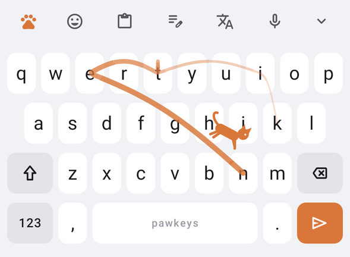 |

**These work in every mode:**
- **Scoot:** slide along the spacebar to move the cursor.
- **Scratch:** slide left from Backspace to select whole words; lift to erase them, or slide back to cancel.
- **Hold Backspace** to repeat, speeding up.
- **Long-press the spacebar** to switch keyboards.

## 11. Den


- **Layout:** five columns of tools, scrollable. Each tool is an icon in a soft circle with a small label. Tools that are switched on (Single paw, Perch, Number row, Gestures, Sound, Haptics) get an accent-tinted circle.
- **Tools:** Emoji · Stickers · GIFs · Translate · Voice · Stash · Groom · Single paw · Perch · Stretch · Coats · Breeds · Number row · Gestures (Flicks / Prowl / off) · Sound (Silent / Click / Kitten / Cat / Duck) · Haptics · Tricks · Settings.

## 12. Emoji and emoji search

| Emoji (light) | Emoji (dark) | Emoji search |
|---|---|---|
|  |  | 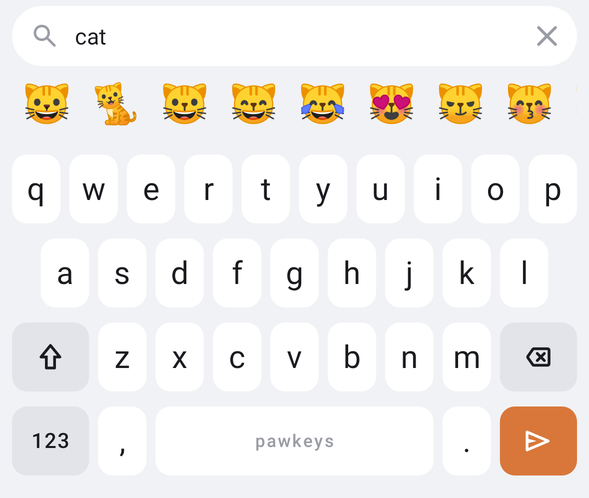 |

- **Layout:** 8 columns with categories along the bottom: Recent, **Cats**, Smileys, Animals, Food, Activities, Travel, Objects, Symbols, Flags. Recent keeps your last 32. Emoji your phone can't draw are hidden.
- **🔍 Search** brings the keys back with a search bar: the query on top and matches underneath.
- **What you can search:**
  - every emoji by its Unicode name (e.g. "pizza", "grinning cat");
  - flags by country ("india");
  - everyday words (lol, love, party, bye…).

## 13. Stickers

| Stickers panel | The Whiskers pack |
|---|---|
| 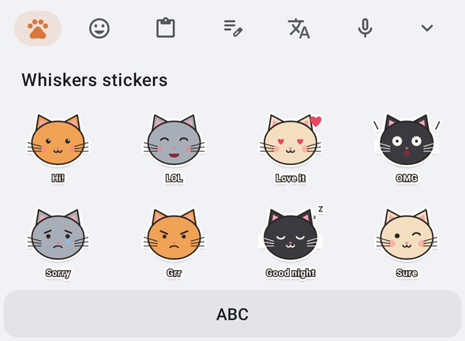 | 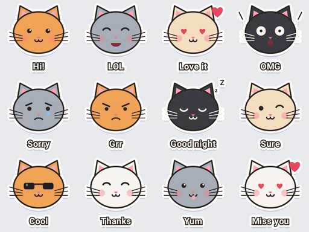 |

**Whiskers** is a pack of 12 original cat-face stickers drawn in code: Hi!, LOL, Love it, OMG, Sorry, Grr, Good night, Sure, Cool, Thanks, Yum, Miss you. Each has a caption and a white die-cut outline. Tap one to send it to the app as an image. If the app doesn't accept images, it's copied so you can paste it.

## 14. GIFs

| Without a key | With a key (tiles stand in for GIFs) |
|---|---|
| 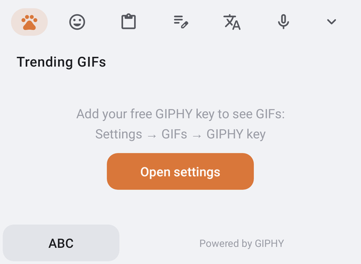 | 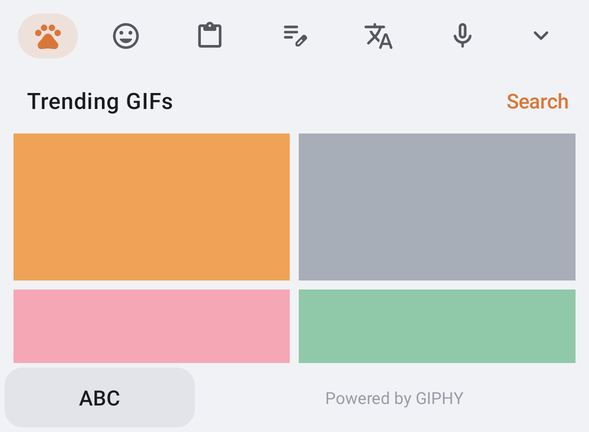 |

- **Panel:** trending GIFs from GIPHY in two columns, animated on Android 9+.
- **Search:** opens the search bar; type a query and press enter.
- **Sending:** tap a GIF to send it, or have it copied if the app can't take GIFs.
- **Your key:** GIFs need **your own free GIPHY key**. Create one at developers.giphy.com, then paste it into **Settings → GIFs → GIPHY key**. It stays on your phone.
- **"Powered by GIPHY"** is shown, as GIPHY's terms require.

## 15. Stash (clipboard)

| Stash | Pinned clip |
|---|---|
|  |  |

- **Cards:** your last 30 copies, each a flat card showing two lines. Tap a card to paste it.
- **Pin and delete:** 📌 pins a clip to keep it forever; 🗑 deletes it. **Clear all** keeps pinned clips.
- **Passwords:** text marked sensitive by the app it came from (e.g. password managers) is never kept.

## 16. Groom (text editing)

| Groom | Select mode on |
|---|---|
|  |  |

- **Cursor pad:** `↑ ← → ↓` (hold to repeat), and `|<` / `>|` for the start or end of the line.
- **Select:** turns accent-coloured; the arrows then extend the selection.
- **Actions:** Select all, Copy, Cut, Paste, Undo, Redo.
- **How it works:** selection moves through the text field directly and copy/paste use the system clipboard, so they work in apps that ignore keyboard shortcut keys (including Samsung's own fields). The cursor steps over whole characters, so emoji stay intact.

## 17. Translate

| Translate bar | Language picker |
|---|---|
|  | 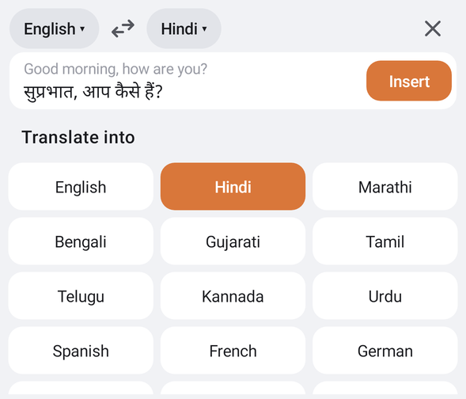 |

- **Bar:** Translate replaces the Whisker bar with `[From ▾] ⇄ [To ▾] ✕` and a line showing what you type and the live translation.
- **Inserting:** your typing goes into the bar, not the app. **Insert** (or Enter) puts the translation into the app.
- **Languages:** 26 to choose from; swap direction with ⇄. The default is English → Hindi.
- **On-device:** uses Google ML Kit. Each language downloads once (~30 MB), then translation works offline and your text never leaves the phone.

## 18. Voice

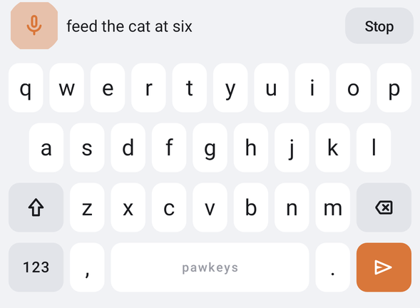

- **Bar:** a mic that pulses with your voice, the words as they're recognised, and **Stop**.
- **Typing:** words appear in the app as you speak and are committed when you pause, with automatic spacing and sentence capitals.
- **Recognizer:** uses the phone's own speech recognizer. The first use asks for microphone permission. Typing any key stops listening.

## 19. Coats (colour themes)


| Calico | Tuxedo | Siamese |
|---|---|---|
|  |  |  |

| Ragdoll | Panther (pure black) | High contrast |
|---|---|---|
|  |  |  |

| Coat | Background | Key | Function key | Text | Accent |
|---|---|---|---|---|---|
| Calico | `#F1F2F5` | `#FFFFFF` | `#E2E4E9` | `#1A1B1F` | `#D9773A` ginger |
| Tuxedo | `#111113` | `#242428` | `#1A1A1D` | `#EDEDF0` | `#EFA262` |
| Siamese | `#F4EFE7` | `#FFFDF9` | `#E8DFD1` | `#2E2621` | `#8A5A3B` seal brown |
| Ragdoll | `#EEF1F7` | `#FFFFFF` | `#DCE2EE` | `#18202E` | `#4A78E0` blue eyes |
| Panther | `#000000` | `#141416` | `#0A0A0B` | `#E8E8EA` | `#C6A6FF` lavender |
| High contrast | `#000000` | black + yellow outline | `#000000` | `#FFE600` | `#FFE600` |

**Auto** (the default) uses the breed's own light and dark colours.

## 20. Stretch, Single paw and Perch

| Stretch (keys resize live) | Stretch at 85% |
|---|---|
|  |  |

| Single paw: right | Single paw: left |
|---|---|
|  |  |

**Stretch**
- `−` and `+` change the height in 5% steps from 70% to 140%; Reset goes back to 100%; ✓ saves.
- In landscape the keyboard is drawn at 78% of the chosen height.

**Single paw**
- The keys take 82% of the width on your side.
- The rail has "full width" and "move to the other side" buttons.

**Perch** (floating keyboard)
- The keyboard becomes a rounded card floating over the app, with a grab handle on top. Drag it anywhere; its position is remembered.
- The dock button snaps it back to normal.
- The app isn't pushed up, and touches outside the card go to the app.

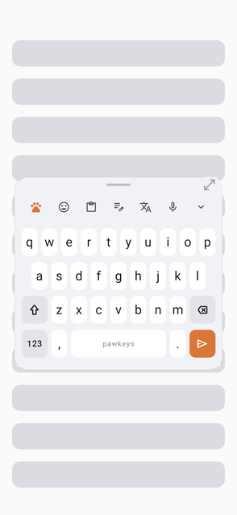

## 21. Key sounds

Pick in **Settings → Feel → Sound** (with a volume slider), or tap **Sound** in the Den to cycle through them; each plays a preview.

| Sound | Character |
|---|---|
| Click | A soft tick |
| Kitten | A tiny, high "mew" |
| Cat | A short "meow" |
| Duck | A nasal "quack" |
| Phone's keyboard sound | The system sound |

- **Origin:** all sounds are original, generated by `tools/make_sounds.py`.
- **Playback:** low-latency, with slight pitch variation per key so typing doesn't sound robotic. Backspace, space and enter use lower pitches.

## 22. Settings app

| Settings | Tricks |
|---|---|
|  |  |

**Top of the screen:** a "Try PawKeys here" box, plus **Get started** (turn PawKeys on, then switch to it). The Get started steps hide once both are done.

| Section | Settings |
|---|---|
| **Look** | Breed, Coat, Key outlines, Number row, Corner hints, Stretch, Single paw |
| **Typing** | Hunches, Auto-fix, Next-word hunches, Memory, Clean hunches, Auto capitals, Double-space full stop, Smart spacing, Tricks, Clear memory |
| **Gestures** | Swipe on letters (Flicks / Prowl / off), Scoot, Scratch, Running cat |
| **Feel** | Key sound, Sound, Sound volume, Haptics, Haptic strength, Key pop-up, Long-press delay |
| **GIFs** | GIPHY key |
| **Stash** | Keep copied text |

---

## 23. Feature list

**F** = from Fleksy · **S** = from Samsung Keyboard · **🐾** = PawKeys' own · ✅ = built and tested

### Look
| | Feature | From |
|---|---|---|
| ✅ | Minimal, spacious PawKeys breed | 🐾 |
| ✅ | Breeds: Samsung, iPhone, Google styles with native colours | 🐾 |
| ✅ | Six coats + Auto, key outlines, high contrast | S + 🐾 |
| ✅ | Stretch (keyboard size), Single paw, Perch (floating) | S |
| ✅ | Number row, corner hints | S |

### Typing
| | Feature | From |
|---|---|---|
| ✅ | Three Hunches, best in the middle | S |
| ✅ | Auto-fix with backspace undo; typos on neighbouring keys weigh less | S/F |
| ✅ | Memory: learns new words; next-word hunches | S |
| ✅ | Long-press a hunch to remove it; clean hunches | S |
| ✅ | Tricks (text shortcuts) with an editor | S |
| ✅ | Auto capitals, double-space full stop, smart spacing | S/F |
| ✅ | Backspacing into a word brings its hunches back | S |
| ✅ | Password and incognito fields: no learning | S |

### Gestures
| | Feature | From |
|---|---|---|
| ✅ | Flicks: space, full stop, delete word, cycle hunches and punctuation | F |
| ✅ | Prowl: swipe typing with a curved trail and a running cat | S + 🐾 |
| ✅ | Scoot, Scratch, hold-to-repeat backspace, long-press space to switch keyboards | S |

### Tools
| | Feature | From |
|---|---|---|
| ✅ | Den with every tool; customizable Whisker bar | S |
| ✅ | Emoji with categories, recents, a Cats tab and search | S + 🐾 |
| ✅ | Stickers: the Whiskers cat pack | S + 🐾 |
| ✅ | GIFs from GIPHY (your own key) | S |
| ✅ | Stash: clipboard history with pins | S |
| ✅ | Groom: cursor, select, copy, cut, paste, undo, redo | S |
| ✅ | Translate, on-device | S |
| ✅ | Voice typing | S |
| ✅ | Key sounds: click, kitten, cat, duck | 🐾 |

### Not built yet
| Feature | Notes |
|---|---|
| Other languages for typing | Needs a word list and layout per language |
| Handwriting | Large separate feature |
| Bitmoji / AR emoji | Needs Snap's SDK or Samsung's own services |
